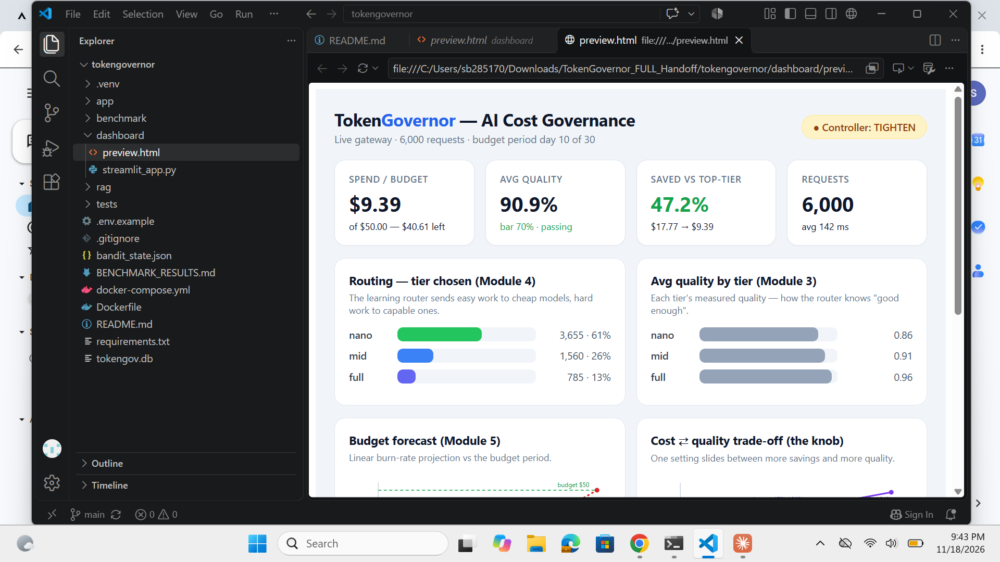
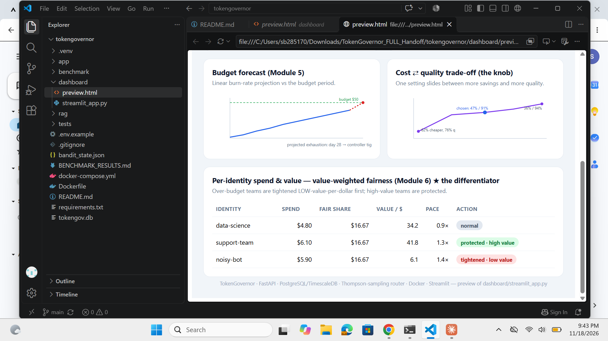

# TokenGovernor — an intelligent AI cost-governance system

TokenGovernor sits between an application and its AI models. For each request it
**classifies** the task, **routes** it to the cheapest model that will clear a
measured **quality** bar, **forecasts** when the budget will run out, and
**tightens its own policy** before the money is gone — and it does the tightening
in a **value-aware** way, throttling low-value spenders before high-value ones.

> **Benchmark headline (reproducible, `python -m benchmark.run_benchmark`):**
> the learning router is **~47% cheaper** than always using the top-tier model,
> while staying **within ~6 points of its quality** — and the savings are tunable
> from **36% to 62%** via a single confidence knob. It learns online (quality
> climbs from ~83% to ~92% over the run) and approaches the theoretical oracle.

It runs **for free with no API key** thanks to a built-in simulator, so you can
run, test, and benchmark the whole system offline. Flip one setting to use real
models.

**🔗 Live demo:** https://token-governor.onrender.com
---

## Why this project (positioning)

Cost-aware LLM gateways are a real, active category (LiteLLM, Portkey, Bifrost).
This is a **working implementation of that pattern, built to understand routing,
evaluation, and forecasting first-hand** — plus one part taken further than
off-the-shelf tools: **value-weighted tightening grounded in measured task
success** (Module 6). Because the core is a gateway that logs every request, the
same codebase also demonstrates **agent observability / reliability**, the #1
unsolved production problem reported by engineers in 2026.

**Skills demonstrated:** FastAPI backend, a contextual bandit (Thompson
sampling), evaluation loops, time-series forecasting, a closed-loop controller,
RAG retrieval, PostgreSQL/TimescaleDB, Docker, a Streamlit dashboard, a rigorous
benchmark with baselines + an oracle, and a full pytest suite.

---

## The six modules

| # | Module | File | What it does |
|---|--------|------|--------------|
| 1 | Gateway + logging | `app/main.py`, `app/models.py` | Intercepts every request; logs cost, tokens, latency, identity, tier, quality |
| 2 | Classifier | `app/classifier.py` | Labels task type + 0–1 complexity before any model call |
| 3 | Quality estimator | `app/quality.py` | Cheap 0–1 quality score (implicit signals; LLM-judge is the upgrade) |
| 4 | Learning router | `app/router.py` | Thompson-sampling bandit: cheapest tier that clears the quality bar |
| 5 | Forecaster + controller | `app/forecaster.py` | Predicts budget exhaustion; auto-selects a tighter mode |
| 6 | Value-weighted fairness | `app/fairness.py` | Per-identity fair share; tightens low-value-per-dollar spenders first |

Supporting pieces: `app/simulate.py` (offline world), `app/tiers.py`,
`app/policy.py` (shared governance state), `rag/` (retrieval workload),
`dashboard/` (Streamlit), `benchmark/` (evaluation).

---

## Quick start (no Docker, ~3 minutes)

```powershell
python -m venv .venv
.\.venv\Scripts\Activate.ps1          # Windows. If blocked, see note below.
pip install -r requirements.txt
$env:DATABASE_URL="sqlite:///./tokengov.db"
$env:MOCK_MODE="true"
uvicorn app.main:app --reload
```

- *If activation is blocked:* run
  `Set-ExecutionPolicy -Scope CurrentUser -ExecutionPolicy RemoteSigned`, then retry.
- Server is up when you see `Uvicorn running on http://127.0.0.1:8000`.

Open **http://localhost:8000/** for the **web UI** — type a prompt, watch the
router pick a model, and see live cost/quality metrics. (The raw API docs are at
**http://localhost:8000/docs**.)

### See the whole system work
In a second terminal (same folder, venv activated):

```powershell
# 1) generate a few hundred mixed requests from 3 different teams
python -m rag.seed_traffic 300

# 2) ask a single RAG question through the governed gateway
python -m rag.ask "What is Acme's return policy?"
```

Then look at:
- **http://localhost:8000/stats** — total spend vs budget, avg quality
- **http://localhost:8000/router** — what the router has *learned* per task type
- **http://localhost:8000/governance** — runs the forecast + fairness loop and
  shows which teams would be tightened and why (this is the self-governing part)

---

## Run with Docker (production-style)

Requires Docker Desktop showing green **"Engine running"**.

```powershell
copy .env.example .env
docker compose up --build
```

This starts TimescaleDB + the gateway together. Reach it at
http://localhost:8000. Stop with `Ctrl+C`, then `docker compose down` (add `-v`
to also wipe the database, e.g. after changing the table schema).

---

## The dashboard

```powershell
streamlit run dashboard/streamlit_app.py
```

A live FinOps view: spend vs budget, the exhaustion forecast, routing mix,
quality by tier, and the per-identity value-weighted fairness table. Keep it
open while you send traffic and refresh to watch it change.


---

## The benchmark 

```powershell
python -m benchmark.run_benchmark
```

Runs the router against baselines (`always_full`, `always_nano`, `random`,
`static_rules`) and an **oracle** upper bound over 6,000 reproducible requests,
prints a cost/quality table, a **cost-vs-quality trade-off curve** (so the result
isn't cherry-picked), and a **learning curve**. Full expected output is in
`BENCHMARK_RESULTS.md`.


---

## Run the tests

```powershell
pip install pytest
python -m pytest -q
```

Covers the classifier, quality scorer, router (including that it *learns*),
forecaster, fairness layer, and the gateway end-to-end.

---

## Using real models (optional)

1. In `.env`, set `MOCK_MODE=false`.
2. Add a key, e.g. `OPENAI_API_KEY=sk-...` (LiteLLM reads it automatically).
3. Send requests as usual. The simulator switches off; real models are called and
   Module 3 scores their real replies. Everything else is identical.

---

